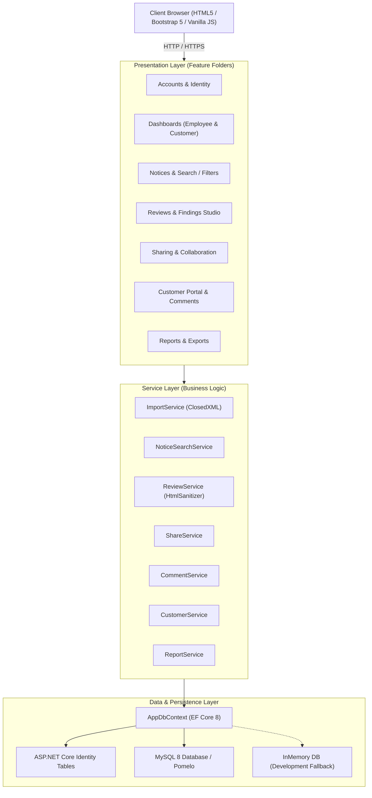
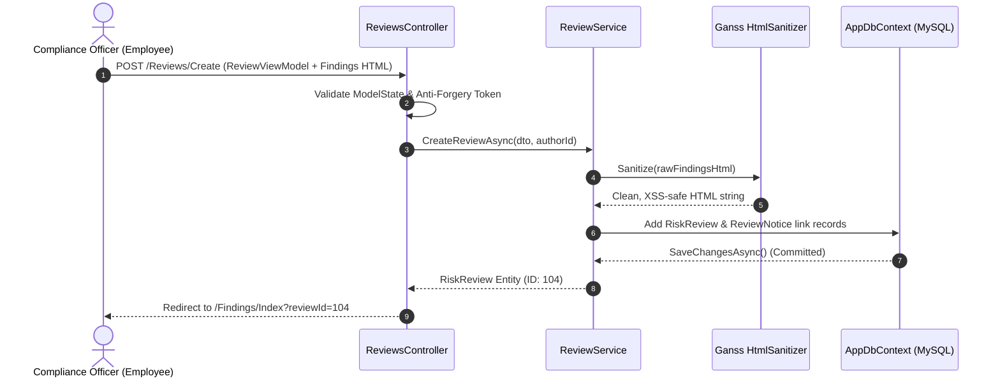

# ANDtr System Architecture & Design Specification

## 1. Architectural Overview

The **ANDtr Medical Device Safety and Recall Notice Platform** is designed as a modular, enterprise-grade ASP.NET Core 8 MVC application. It adheres to a clean separation of concerns using **Feature Folders**, a dedicated **Service Layer**, and an **Entity Framework Core 8 Data Layer** backed by MySQL 8 (with transparent in-memory fallback for local environments).



---

## 2. Solution Directory Structure

The project employs a domain-driven Feature Folder pattern to maximize cohesion and make code ownership unambiguous:

```text
ANDtr/
├── src/
│   └── ANDtr.Web/
│       ├── Common/                       # Shared attributes, helpers, and extensions
│       ├── Data/                         # EF Core DbContext, Seeder, and Migrations
│       │   ├── AppDbContext.cs
│       │   ├── DbSeeder.cs
│       │   └── Migrations/
│       ├── Features/                     # Feature Folders (Controllers + ViewModels + Views)
│       │   ├── Accounts/                 # Login, Logout, AccessDenied
│       │   ├── Customers/                # Customer Account Management
│       │   ├── Dashboard/                # Role-specific Dashboards (Employee & Customer)
│       │   ├── Filters/                  # Parametric Notice Filtering
│       │   ├── Findings/                 # Clinical Findings Studio & Rich Text Editor
│       │   ├── Import/                   # ClosedXML Excel Notice Ingestion
│       │   ├── Notices/                  # Notice Detail Specification
│       │   ├── Reports/                  # Executive Print Reports & CSV Generation
│       │   ├── Reviews/                  # Risk Review Authoring & Status Management
│       │   ├── Search/                   # Keyword & Synonym Search with Selection Basket
│       │   ├── SharedReviews/            # Customer Portal, Shared Review Inspection & Comments
│       │   └── Sharing/                  # Multi-party Customer Sharing & Revocation
│       ├── Models/                       # Core Domain Entities
│       ├── Services/                     # Service Interfaces and Business Logic
│       ├── Views/Shared/                 # Shared layouts (_Layout, _EmployeeLayout, _CustomerLayout)
│       ├── wwwroot/                      # Static assets (site.css, site.js, Bootstrap 5)
│       ├── appsettings.json
│       └── Program.cs                    # Application bootstrapping and DI composition
├── tests/
│   └── ANDtr.Tests/                      # xUnit integration and unit tests
│       ├── ImportServiceTests.cs
│       ├── NoticeSearchServiceTests.cs
│       ├── ReviewServiceTests.cs
│       └── ShareServiceTests.cs
├── data/                                 # Sample datasets (FDAdataset.xlsx)
├── docs/                                 # Architectural and operational documentation
├── wireframes/                           # Source HTML wireframes
├── docker-compose.yml                    # MySQL 8 container configuration
└── ANDtr.sln
```

---

## 3. Data Flow & Request Lifecycle



---

## 4. Key Subsystem Deep Dives

### 4.1 Excel Ingestion Pipeline (`ImportService`)
- **Technology:** `ClosedXML` (`0.102.2`).
- **Processing Flow:**
  1. Validates `.xlsx` file extension and non-empty stream.
  2. Dynamically detects header row containing columns: `Recall Number`, `Product Description`, `Reason for Recall`, `Classification`, `Recalling Firm`, etc.
  3. Sanitizes XML carriage returns (`_x000D_\n` -> standard `\n`).
  4. Parses date fields supporting multiple international formats (`yyyy-MM-dd`, `MM/dd/yyyy`, `dd/MM/yyyy`, and Excel serial dates).
  5. Performs idempotency check against `RecallNumber` to detect and record duplicate notices without corrupting database integrity.
  6. Creates an `ImportRecord` audit entry logging row counts, new additions, duplicates, and timestamp.

### 4.2 Cross-Page Notice Selection Basket (`wwwroot/js/site.js`)
- **Mechanism:** HTML5 `sessionStorage`.
- **Workflow:**
  1. As users navigate paginated search results (`/Search/Results?page=2`), checkbox selections emit change events.
  2. IDs are stored in `sessionStorage.getItem('andtr_selected_notices')`.
  3. When an employee clicks "Create Review with Selected Notices", the basket items are serialized into hidden form fields and submitted directly to `/Reviews/Create`.
  4. Once the review is saved, the basket is cleared.

### 4.3 Rich-Text Findings & XSS Defense (`Ganss.Xss.HtmlSanitizer`)
- **Editor:** Lightweight vanilla JS execCommand toolbar (Bold, Italic, Underline, Bullet List, Numbered List, Headings, Quotes) operating on a `contenteditable` container.
- **Security:** Raw HTML from client inputs is parsed server-side via `HtmlSanitizer`:
  - Allowed tags: `p`, `b`, `i`, `u`, `strong`, `em`, `ul`, `ol`, `li`, `h3`, `h4`, `blockquote`, `br`.
  - Disallowed: `script`, `iframe`, `object`, `style`, inline event handlers (`onload`, `onerror`).
  - Output is strictly rendered using `@Html.Raw()` only after server-side sanitization.

### 4.4 Multi-Party Sharing & Customer Access Control (`ShareService`)
- Reviews are private to ANDtr employees by default.
- Employees can grant access to one or more customer organizations (`ApplicationUser` where `UserType == UserType.Customer`).
- `ReviewShare` entity links `RiskReviewId` to `CustomerId`.
- **Authorization Enforcement:** In `SharedReviewsController`, every query verifies:
  ```csharp
  var hasAccess = await _context.ReviewShares
      .AnyAsync(s => s.RiskReviewId == reviewId && s.CustomerId == currentUserId && s.IsActive);
  if (!hasAccess) return Forbid();
  ```
- Instant Revocation sets `IsActive = false` and updates `RevokedAt`, instantly terminating customer access.

### 4.5 Two-Way Comment Threads (`CommentService`)
- Stakeholders (both Customers and Employees) can leave threaded comments on shared reviews.
- Comments can be flagged with `IsHospitalQuery = true`.
- An automated status calculation evaluates `ReviewShare.AwaitingReply`:
  - If the last comment is from the Customer, `AwaitingReply = true` (prompting employee action).
  - When an Employee responds, `AwaitingReply = false`.

### 4.6 Reporting Engine (`ReportService`)
- **Print / PDF:** Structured Razor view (`Features/Reports/Views/Index.cshtml`) styled with responsive `@media print` rules:
  - Hides navigation bars, buttons, and footers.
  - Formats clinical impact matrices, notice summaries, and finding blocks.
  - Forces clean page breaks before major sections (`page-break-inside: avoid;`).
- **CSV Export:** Streams comma-separated RFC 4180 compliant data directly to the client browser with `text/csv` MIME type and appropriate `Content-Disposition`.

---

## 5. Security & Authentication Architecture

1. **Identity & Roles:**
   - Built on standard ASP.NET Core Identity.
   - Roles: `Employee` (System Administrator / Clinical Safety Officer) and `Customer` (Hospital Representative / Procurement Specialist).
2. **Controller Protection:**
   - Default controller authorization with `[Authorize(Roles = "Employee")]`.
   - Customer features explicitly protected with `[Authorize(Roles = "Customer")]`.
3. **Data Protection:**
   - Anti-forgery tokens (`@Html.AntiForgeryToken()` / `[ValidateAntiForgeryToken]`) enforced across all mutation endpoints.
   - Soft-delete semantics on customer activation (`IsActive = false`).
