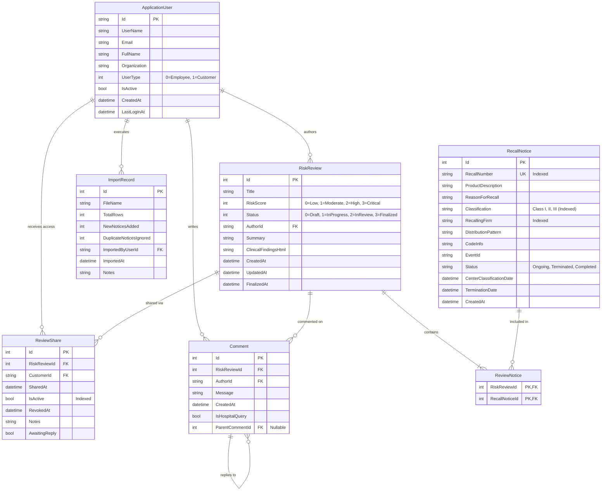

# ANDtr Database Entity-Relationship (ER) Specification

## 1. Entity-Relationship Diagram

---

## 2. Table Specifications & Indexes

### 2.1 `RecallNotices`
Stores all FDA recall records extracted from external datasets or live feeds.
- **Primary Key:** `Id` (INT, Auto Increment)
- **Indexes:**
  - `IX_RecallNotices_RecallNumber` (UNIQUE) — Guarantees fast lookup and prevents duplicate recall imports.
  - `IX_RecallNotices_Classification` — Optimizes filtering on Class I, II, and III.
  - `IX_RecallNotices_RecallingFirm` — Optimizes firm-specific queries and aggregations.
  - `IX_RecallNotices_CenterClassificationDate` — Enables efficient date range searches and sorting.

### 2.2 `RiskReviews`
Clinical evaluations and regulatory assessments authored by ANDtr employees.
- **Primary Key:** `Id` (INT, Auto Increment)
- **Foreign Keys:**
  - `AuthorId` -> `AspNetUsers(Id)` (ON DELETE RESTRICT)
- **Indexes:**
  - `IX_RiskReviews_Status` — Filters dashboard lists (Draft, Finalized, etc.).
  - `IX_RiskReviews_RiskScore` — Filters reviews by severity level.
  - `IX_RiskReviews_CreatedAt` — Default reverse-chronological ordering.

### 2.3 `ReviewNotices`
Many-to-many join table associating recall notices with risk reviews.
- **Composite Primary Key:** (`RiskReviewId`, `RecallNoticeId`)
- **Foreign Keys:**
  - `RiskReviewId` -> `RiskReviews(Id)` (ON DELETE CASCADE)
  - `RecallNoticeId` -> `RecallNotices(Id)` (ON DELETE RESTRICT)

### 2.4 `ReviewShares`
Grants read access and tracks active collaboration states between ANDtr reviews and external customer accounts.
- **Primary Key:** `Id` (INT, Auto Increment)
- **Foreign Keys:**
  - `RiskReviewId` -> `RiskReviews(Id)` (ON DELETE CASCADE)
  - `CustomerId` -> `AspNetUsers(Id)` (ON DELETE RESTRICT)
- **Indexes:**
  - `IX_ReviewShares_RiskReviewId_CustomerId` — Prevents duplicate share links.
  - `IX_ReviewShares_CustomerId_IsActive` — Fast lookup for customer dashboard active views.

### 2.5 `Comments`
Threaded discussion records on risk reviews between customers and employees.
- **Primary Key:** `Id` (INT, Auto Increment)
- **Foreign Keys:**
  - `RiskReviewId` -> `RiskReviews(Id)` (ON DELETE CASCADE)
  - `AuthorId` -> `AspNetUsers(Id)` (ON DELETE RESTRICT)
  - `ParentCommentId` -> `Comments(Id)` (ON DELETE NO ACTION / Nullable)

### 2.6 `ImportRecords`
Auditing entity logging every Excel import execution, user who performed it, and metrics.
- **Primary Key:** `Id` (INT, Auto Increment)
- **Foreign Keys:**
  - `ImportedByUserId` -> `AspNetUsers(Id)` (ON DELETE RESTRICT)
