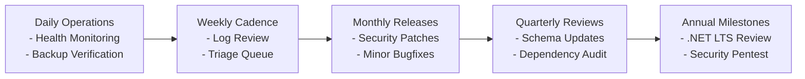

# ANDtr 2-Year Software Maintenance & Operational Plan

## 1. Executive Summary & Objective

This document defines the 2-year Software Maintenance, Evolution, and Reliability Plan for the **ANDtr Medical Device Safety and Recall Notice Platform**. 
As a critical regulatory compliance and patient safety system, ANDtr must maintain high availability, data integrity, auditability, and responsiveness to evolving FDA regulatory reporting schemas and health authority standards.

---

## 2. Maintenance Schedule & Release Cadence



| Frequency | Maintenance Scope | Responsible Role | Key Deliverables |
| :--- | :--- | :--- | :--- |
| **Continuous / Daily** | Automated container health checks, database disk space tracking, error log alerting. | SRE / DevOps | Uptime reports, failed job alerts. |
| **Weekly** | Triage customer inquiries (`AwaitingReply`), review unhandled exceptions in Serilog/Application Insights. | Lead Developer | Weekly bug triage board update. |
| **Monthly** | OS security patching, minor NuGet library updates, database query index optimization. | Backend Engineer | Staging release, regression test run. |
| **Quarterly** | FDA schema validation review, user access audits (deactivating stale hospital accounts). | Compliance Lead & Tech Lead | Schema evolution RFC, dependency audit. |
| **Annual** | Major framework migration assessment (.NET LTS updates), full penetration test. | Enterprise Architect | Major release roadmap and audit sign-off. |

---

## 3. Schema Evolution: Adding New FDA Recall Fields

When the FDA updates its openFDA API or export format (e.g. adding Unique Device Identification `UDI-DI` or Global Medical Device Nomenclature `GMDN` codes):

### Step-by-Step Evolution Procedure:
1. **Update Domain Entity (`Models/RecallNotice.cs`):**
   ```csharp
   [MaxLength(100)]
   public string? UdiDi { get; set; }
   ```
2. **Generate EF Core Migration:**
   ```bash
   dotnet ef migrations add AddUdiDiToRecallNotices --project src/ANDtr.Web
   ```
3. **Update Excel Ingestion Parser (`Services/ImportService.cs`):**
   - Add column index lookup in `FindHeaderColumns`:
     ```csharp
     else if (header.Contains("UDI") || header.Contains("DEVICE IDENTIFIER")) udiCol = col;
     ```
   - Bind value during row extraction.
4. **Update Search Criteria & Filters (`Services/NoticeSearchService.cs`):**
   - Add `UdiDi` filter property to `NoticeSearchCriteria`.
   - Update expression tree query in `SearchNoticesAsync`.
5. **Update Razor Views (`Features/Notices/Views/Details.cshtml` and `Search/Views/Results.cshtml`):**
   - Display the new field in notice specification tables.
6. **Automated Migration Verification:**
   - Run `dotnet test` to confirm `ImportServiceTests` and `NoticeSearchServiceTests` pass without regression.

---

## 4. Role & Permission Expansion Strategy

To introduce new roles (e.g. `HospitalAuditor` or `RegulatoryLiaison`):

1. **Update Role Constants & Enums (`Models/ApplicationUser.cs`):**
   ```csharp
   public enum UserType
   {
       Employee = 0,
       Customer = 1,
       Auditor = 2
   }
   ```
2. **Register Role in Seeder (`Data/DbSeeder.cs`):**
   ```csharp
   if (!await roleManager.RoleExistsAsync("Auditor"))
   {
       await roleManager.CreateAsync(new IdentityRole("Auditor"));
   }
   ```
3. **Define Granular Authorization Policies (`Program.cs`):**
   ```csharp
   builder.Services.AddAuthorization(options =>
   {
       options.AddPolicy("CanViewFindings", policy =>
           policy.RequireRole("Employee", "Auditor"));
       options.AddPolicy("CanEditReviews", policy =>
           policy.RequireRole("Employee"));
   });
   ```
4. **Decorate Controllers & Action Methods:**
   - Apply `[Authorize(Policy = "CanViewFindings")]` to read-only endpoints.

---

## 5. Database Backup, Recovery & Disaster Planning

### 5.1 Automated Nightly Backup Script (MySQL 8)
Store backups in encrypted off-site cloud storage (e.g. AWS S3 with KMS or Azure Blob Storage):
```bash
#!/usr/bin/env bash
set -e
TIMESTAMP=$(date +"%Y%m%d_%H%M%S")
BACKUP_DIR="/var/backups/andtr_mysql"
mkdir -p "$BACKUP_DIR"

# Perform consistent online logical dump with single transaction
docker exec andtr_mysql mysqldump \
  --single-transaction \
  --quick \
  --routines \
  --triggers \
  -u andtr_user -pandtr_password andtr_db \
  | gzip > "$BACKUP_DIR/andtr_db_$TIMESTAMP.sql.gz"

# Retain last 30 daily backups locally
find "$BACKUP_DIR" -type f -name "*.sql.gz" -mtime +30 -delete
```

### 5.2 Point-in-Time Recovery (PITR) Procedure
1. Stop the application instance to prevent data drift:
   ```bash
   docker stop andtr_web
   ```
2. Restore latest baseline dump:
   ```bash
   gunzip < andtr_db_20261017_020000.sql.gz | docker exec -i andtr_mysql mysql -u andtr_user -pandtr_password andtr_db
   ```
3. Apply binary logs (`mysqlbinlog`) up to the recovery target timestamp.
4. Verify table row counts and start web service.

---

## 6. Dependency & Framework Lifecycle (.NET LTS)

- **Current Baseline:** .NET 8.0 LTS (Supported by Microsoft through November 2026).
- **Target Upgrade:** .NET 10.0 LTS (Releasing November 2025; migrate in Q2 2026).
- **NuGet Upgrade Protocol:**
  - Automated weekly dependency scans using `dotnet list package --outdated`.
  - Security vulnerability monitoring using `dotnet list package --vulnerable`.
  - Upgrades tested in staging container before production deployment.

---

## 7. Performance & Observability Guidelines

1. **Slow Query Alerting:**
   - Log queries exceeding 500ms via EF Core logging threshold.
   - Run `EXPLAIN` on `RecallNotices` queries to verify composite index utilization on `RecallNumber`, `Classification`, and `RecallingFirm`.
2. **Health Endpoints:**
   - `/health` endpoint checks database responsiveness and disk volume writeability.
3. **Rich Text Content Auditing:**
   - Regularly audit `ClinicalFindingsHtml` content to ensure HtmlSanitizer rules continue to defend against evolving XSS techniques.
